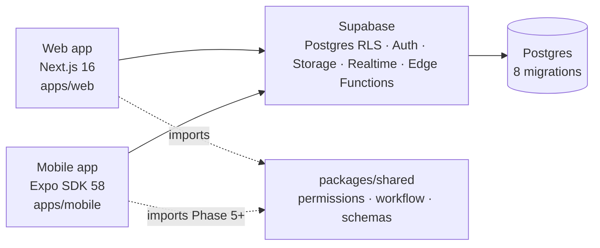

# ARCHITECTURE

One backend, two frontends, a shared contract library. No custom server runtime —
all authorization lives in Postgres.

Layers:

| Layer       | Where            | Responsibility                                                      |
| ----------- | ---------------- | ------------------------------------------------------------------- |
| Web UI      | `apps/web/src`   | pages, screens, gating UI that mirrors DB rules (never trusts them) |
| Mobile UI   | `apps/mobile/src`| site-first flows; later an offline outbox (Phase 6)                 |
| Contracts   | `packages/shared`| roles, permission matrix, transition map, zod schemas — UI gating only |
| Backend     | `supabase/`      | RLS policies, guard triggers, SECURITY DEFINER RPCs, storage        |
| Data        | `supabase/migrations` | schema — mutable ONLY via new migration files                  |

Key architectural decisions (rationale in `docs/DECISIONS.md`):

- AuthZ is enforced in Postgres. Roles are synced into JWT claims; policies call helpers.
- Workflow-changing fields (status/assignee/fix fields) are writable only through RPCs;
  a guard trigger rejects direct writes to them.
- Snag numbers are assigned by trigger with a row lock on `projects` (concurrency-safe).
- Offline writes are made idempotent by `snags.client_id` unique constraint.
- Filenames: photo storage path `{project_id}/{snag_id}/{uuid}` per bucket policies.
